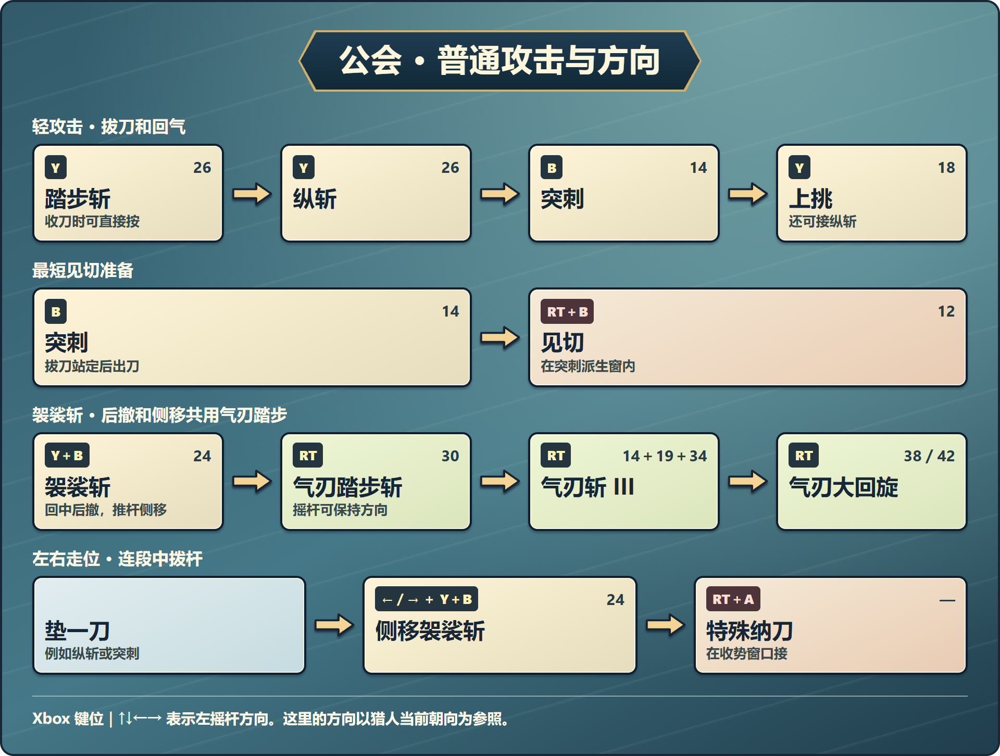
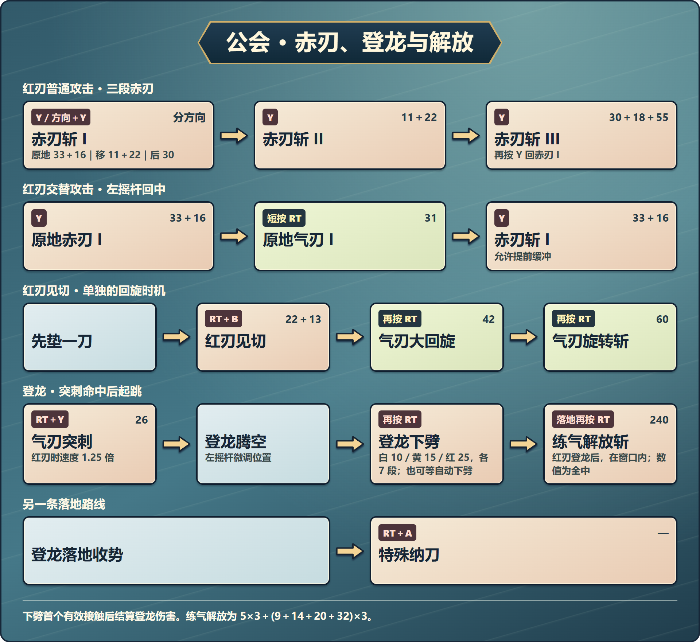

# MHGU Yuzu ZR 太刀整合版

把《世界／冰原》的见切、居合、登龙和《荒野》的赤刃、气刃蓄力、练气解放带进《怪物猎人 GU》。六种狩猎风格都能用这套太刀，勇气刚气刃、武士道无双斩等原生招式仍可使用。

**[下载 v1.2.28 整合包](https://github.com/skeyep/MHGU-Yuzu-ZR/releases/download/v1.2.28/MHGU-Yuzu-ZR-v1.2.28.zip)** · [更新记录](CHANGELOG.md) · [来源与修改说明](SOURCES.md) · [项目源码](source/BUILD.md)

v1.2.28 勇气风格恢复原生普通斩和刚气刃连段。收刀移动时按住 RB 跑步，RT 气刃拔刀。见切和居合可积攒勇气槽，登龙和无双斩按招式消耗勇气槽。

v1.2.27 武士道大居合成功后按 Y 进入拖刀。拖刀减速时自动接一文字，途中重新按 Y 仍可提前出刀。红刃时，大居合、小居合、红刃见切和大回旋派生的气刃突刺统一从第 0 帧起手，以 1.25 倍速播放。

v1.2.26 同一集会所的玩家都安装 1.2.26 后，可以看到对方的太刀动作，听到气刃兜割命中的音效。太刀击中眩晕队友可将其打醒，击中正常队友时可继续蓄力或出招。气刃大回旋收招时按 RT＋Y 可接气刃突刺，开刃命中后接登龙。

v1.2.25 气刃突刺在红刃命中后，登龙升空、下劈到落地结算期间保留剩余红刃时间。大回旋、气刃旋转斩和武士道气刃无双斩只接红刃见切，各档仍可接特殊纳刀。

v1.2.24 RT＋B 可在樱花、圆月和镜花成功反击的后摇接见切。武士道一文字与无双斩、红刃大回旋、蓄力起手和登龙落地也可在各自窗口派生。见切不能直接接见切。

v1.2.23 三种普通袈裟斩收势时，保持前推并点按 RT 可接气刃踏步斩。登龙被打断时会释放位移并清除待执行的输入。大居合的自动转镜在动作或动画切换时结束。

v1.2.21 武士道大居合成功后的 Y 预输入按动作帧结算。首次有效按键锁定拖刀时机，连按和命中停顿不会重置计时。拖刀中的第二次 Y 仍由 GU 判定何时能接一文字。

v1.2.20 修复武士道大居合按 Y 进入拖刀后，同一帧继续执行旧动作更新、掉回普通移动的问题。

v1.2.19 武士道大居合反击成功后，第一次 Y 接原生拖刀，松开再按 Y 出一文字斩。气刃足够时，按 RT 接原生气刃无双斩。

v1.2.18 修复收刀冲刺时 RB 被当成武器 RT、移动拔刀可能误出气刃突刺并接兜割的问题。

v1.2.17 修复气刃大回旋命中后升刃结算被拔刀检查覆盖的问题。

v1.2.16 提前樱花气刃斩接特殊纳刀，统一红刃普通斩击及兜割加速。

v1.2.15 红刃收刀按 Y 时，站定出原地赤刃 I，移动或奔跑出移动赤刃 I。修复首次移动拔刀偶尔进入原生踏步斩的问题。

v1.2.14 扩展大回旋的刀身判定，修正红刃拔刀和特殊纳刀误翻滚。

适用 **Windows Yuzu 1734** 和 **MHGU 国际版 1.4.0**（`0100770008DD8000`）。包内有太刀、Forge 1.5.1、伤害跳字、快捷轮盘和可选 Xbox 按键提示。游戏、模拟器、存档和密钥由玩家自行准备。

## 安装

1. 退出游戏。下载并解压 Releases 中的 `MHGU-Yuzu-ZR-v1.2.28.zip`，双击 **Install.cmd**。
2. 如果安装器列出重复的太刀、Forge、跳字或轮盘插件，把对应旧目录移到游戏模组目录之外，再运行安装器。
3. 到 Yuzu 的游戏属性，启用 **MHGU-ZR-Integrated**。启用 **MHGU-Xbox-Prompts** 可显示 Xbox 按键。切换提示后重启游戏。
4. 在 Yuzu 控制器配置里确认 Xbox **RT 对应 ZR**，**RB 对应 R**，**LT 对应 ZL**，**LB 对应 L**。

便携版和自定义数据目录可传入 `Install.cmd -ModRoot "游戏模组数据位置" -SdmcRoot "Yuzu 的 SDMC 目录"`。检查用 `Install.cmd -Action Check`，移除用 `Install.cmd -Action Remove`。安装或移除会输出备份位置，恢复时把备份移回模组目录并还原原目录名。

## 怎么打

| Xbox 按键 | 招式 |
| --- | --- |
| RT | 气刃斩。收刀时单按出气刃拔刀，推摇杆出四向移动气刃 I。空中调用 GU 原生跳跃气刃。 |
| RT＋A | 特殊纳刀。樱花气刃斩、气刃大回旋、武士道和勇气终结斩都可在收势时接。 |
| RT＋B | 先出一刀，再在这招的派生窗口按 RT＋B 见切。 |
| RT＋Y | 气刃突刺，收刀时也可用。开刃后命中可接登龙，红刃起手的登龙落地后，单按 RT 接练气解放。 |
| 特殊纳刀后 Y／重新按 RT | 小居合／大居合。大居合反击成功且刀命中可升刃，勇气风格获得勇气槽。 |
| 在可派生的攻击后长按 RT | 气刃蓄力，填充原生气刃槽。气刃 III 后直接满蓄。按住可走停，松键出刀。 |
| 红刃收刀时 Y | 站定、行走或奔跑中直接出赤刃 I。 |
| RB | 按住并推摇杆，收刀奔跑。勇气风格原地按 RB 不发动武器动作。 |

红刃普通 **Y** 拔刀出赤刃 I，原地短按 **RT** 可接气刃 I。红刃大回旋收势时，单按 **RT** 接气刃旋转斩，**RT＋A** 接特殊纳刀。空中是单刀还是三连斩，由 GU 原生的风格、刃色和气刃槽条件决定。

**狩技**用游戏的 **2 型操作**。LT＋Y、LT＋X、LT＋A 分别对应第 1、2、3 个狩技，优先于太刀连段。**快捷轮盘**在任务内按住 LB，用右摇杆选道具。首次安装默认放在右下，图标为 Xbox 风格。轮盘的设置在游戏菜单第 3 页。

## 连携图与动作值

卡片上方是 **Xbox 按键**，右侧数字是 **GU 1.4.0 载入整合版后的动作值**。多段攻击逐段列出。实际掉血还受刃色、斩味和肉质影响。 [v1.2.13 文字连携和动作值](docs/combos.md) · 下方配图对应 v1.2.11。

### 公会

**普通斩与走位。** 拔刀站定后可以用 B 突刺垫刀，再接见切。Y＋B 可出袈裟斩，连段中配合摇杆可侧移。公会三种袈裟收势都可按 RT 接气刃踏步斩，摇杆可以保持方向。

**气刃和蓄力。** 短按 RT 走气刃连段，长按走蓄力。气刃 I、II 后承接蓄力进度，气刃 III 后直接满蓄。蓄力时可迈步、停步和转向，松开 RT 才出刀。

**见切、纳刀、居合。** 非红刃见切先迎击并打中回斩，再按 RT 接大回旋。小居合收势时按 RT＋A 可再次特殊纳刀。大居合 GP 成功后，收势时重新短按 RT 走气刃 III 路线，RT＋A 可再次纳刀。长按 RT 按 GP 成败进入 III 或 II 段蓄力，RT＋Y 在两种情况下都可接气刃突刺。升刃需要 GP 成功且刀命中。 [大小居合的派生](docs/combos.md#大小居合的派生)

**红刃和登龙。** 红刃时 Y 走赤刃。开刃后 RT＋Y 的气刃突刺命中可腾空接登龙。红刃登龙落地后，可在派生窗口再按 RT 接练气解放斩。

### 其他五种风格

强袭、空战、武士道、勇气和炼金共用整合招式。输入窗口和原生气刃收尾随风格变化。

勇气风格收刀移动时按住 **RB** 跑步，按 **RT** 气刃拔刀。入蓝后，**Y** 接原生普通斩，**RT** 接刚气刃。地面攻击收势时按 **X** 可进入勇气纳刀，小居合从第 24 帧起可预输入，最早第 42 帧接上。

勇气槽上限为 1,000 点。见切、小居合或大居合成功迎击并命中时，入蓝前基础增加 90 点，入蓝后基础回复 18 点。原生加槽技能的倍率仍然生效。其他原本升刃的奖励也计入勇气槽。蓝刃登龙升空消耗 30 点，下劈再耗 25 点，完整一套共 55 点。气刃无双斩终结消耗 35 点。蓝刃登龙沿用红刃伤害档，落地按普通登龙收势。

武士道大居合 GP 成功后按 **Y** 进入拖刀，拖刀减速时自动出一文字斩。拖刀中松开再按 **Y** 可在原生窗口提前出刀，气刃足够时再按 **RT** 接气刃无双斩，收势按 **RT＋A** 特殊纳刀。原生精准回避后的 Y 也能进入同一条路线。

移动气刃后接一文字，武士道先用 A 精准回避，勇气先长按 X 进入原生纳刀持续，随后都按 Y。 [拖刀、移动气刃与一文字斩](docs/combos.md#拖刀移动气刃与一文字斩)

### 狩技

用 2 型操作时，按住 LT 后按 Y／X／A，分别释放对应狩技槽。樱花气刃斩最后收势可以按 RT＋A 接特殊纳刀。其他狩技在回到可操作状态后按原生持刀状态继续。

## 这版改了什么

- 按住 RB 奔跑时可用 Y 或 RT 拔刀。红刃 Y 出赤刃 I，带方向的 RT 出移动气刃 I，RT＋Y 出气刃突刺。
- 按招式修正赤刃、方向气刃、见切、纳刀、居合与练气解放的预输入和执行窗口。早按、松键与实际派生都按当前动作计时。
- 红刃起手的登龙落地后，单按 RT 接练气解放斩。

联机时建议双方安装同一版，以便各自加载相同的动作资源。

## English quick start

In Valor Style, hold **RB** and move to sprint with the sword sheathed. Press **RT** for a Spirit draw. In blue Valor mode, **Y** follows the native slash combo and **RT** continues the native Valor Spirit Blade chain. Press **X** during a grounded attack’s recovery for Valor Sheathe. After Iai Slash, X can be buffered from frame 24 and the stance can start at frame 42.

The Valor Gauge holds 1,000 points. A successful Foresight Slash, Iai Slash or Iai Spirit Slash counter must land its cut to add 90 base points before blue mode or restore 18 during blue mode. Native gauge-gain skill multipliers apply. Other Spirit-level rewards also build or refill the Valor Gauge. In blue mode, Helm Breaker costs 30 points on ascent and 25 on descent, for a total of 55. The Spirit Reckoning finisher costs 35 points. Blue Helm Breaker uses red-tier damage and the standard landing recovery.

After a successful Adept Iai Spirit Slash, press Y to dash. The dash now links into Ichimonji as it slows. Press Y again during the dash for an earlier cut. At red Spirit level, Spirit Thrust now starts at frame zero and plays at 1.25× speed from either Iai slash, red Foresight Slash or Spirit Roundslash.

With 1.2.28 installed on all participating clients, each hunter can see other players perform Long Sword moves and hear the Spirit Helm Breaker impact. A blade hit wakes a stunned teammate and lets an active teammate keep attacking or charging. Press RT + Y during Spirit Roundslash recovery to link into Spirit Thrust. A hit with an active Spirit level starts Helm Breaker.

For **Windows Yuzu 1734** and **international MHGU 1.4.0**. Download the [v1.2.28 release ZIP](https://github.com/skeyep/MHGU-Yuzu-ZR/releases/tag/v1.2.28), close the game, extract it, and run **Install.cmd**. Enable **MHGU-ZR-Integrated** and optionally **MHGU-Xbox-Prompts** in Yuzu.

All six hunting styles can use Foresight, Special Sheathe, Iai and Helm Breaker. Styles that reach red Spirit level also gain Crimson Slash and the red Helm Breaker follow-up, Spirit Release. **RT** (Switch ZR) handles Spirit attacks, including native aerial draws. With the sword sheathed, hold a direction with RT for moving Spirit Blade I. **RT+A** is Special Sheathe, **RT+B** is Foresight, and **RT+Y** is Spirit Thrust. Hold **LB** for the item wheel. Use Type 2 controls for Hunter Arts with **LT+Y**, **LT+X**, and **LT+A**.

[Credits and changes](SOURCES.md) · [Changelog](CHANGELOG.md)
