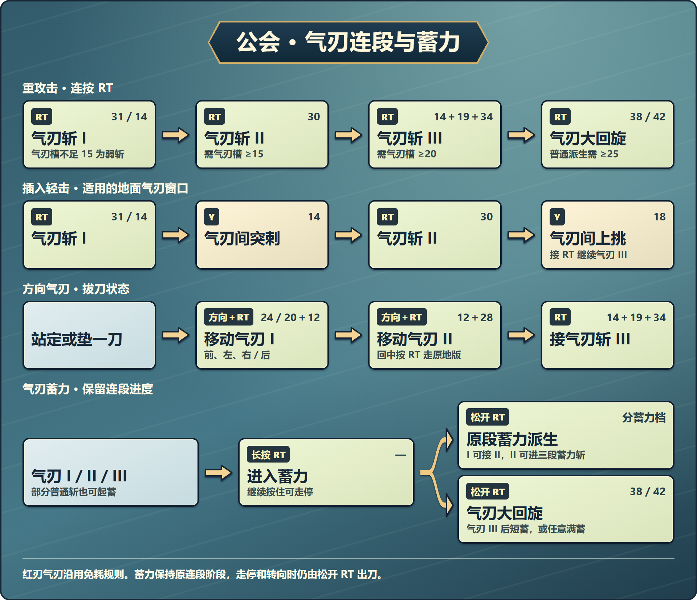
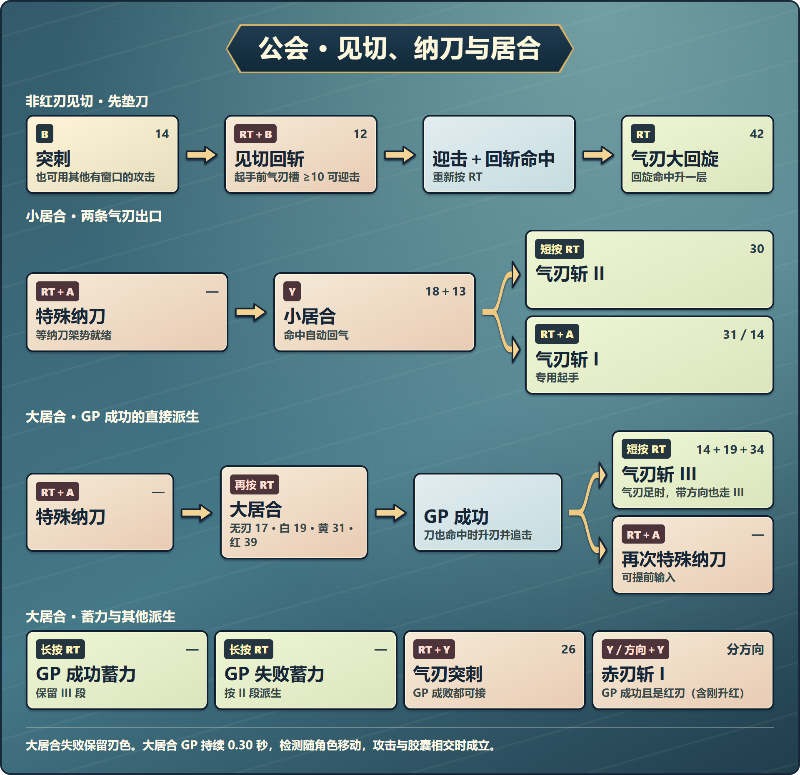
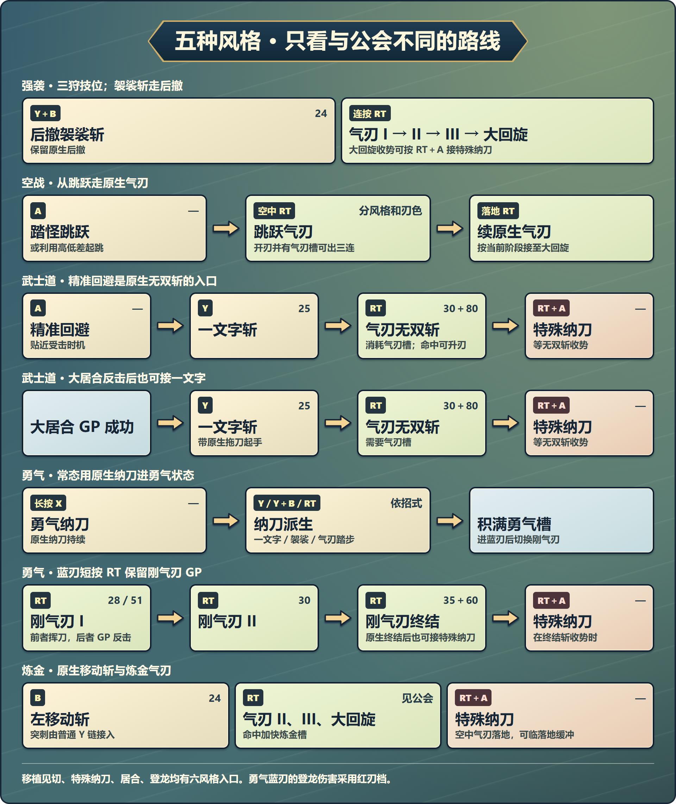
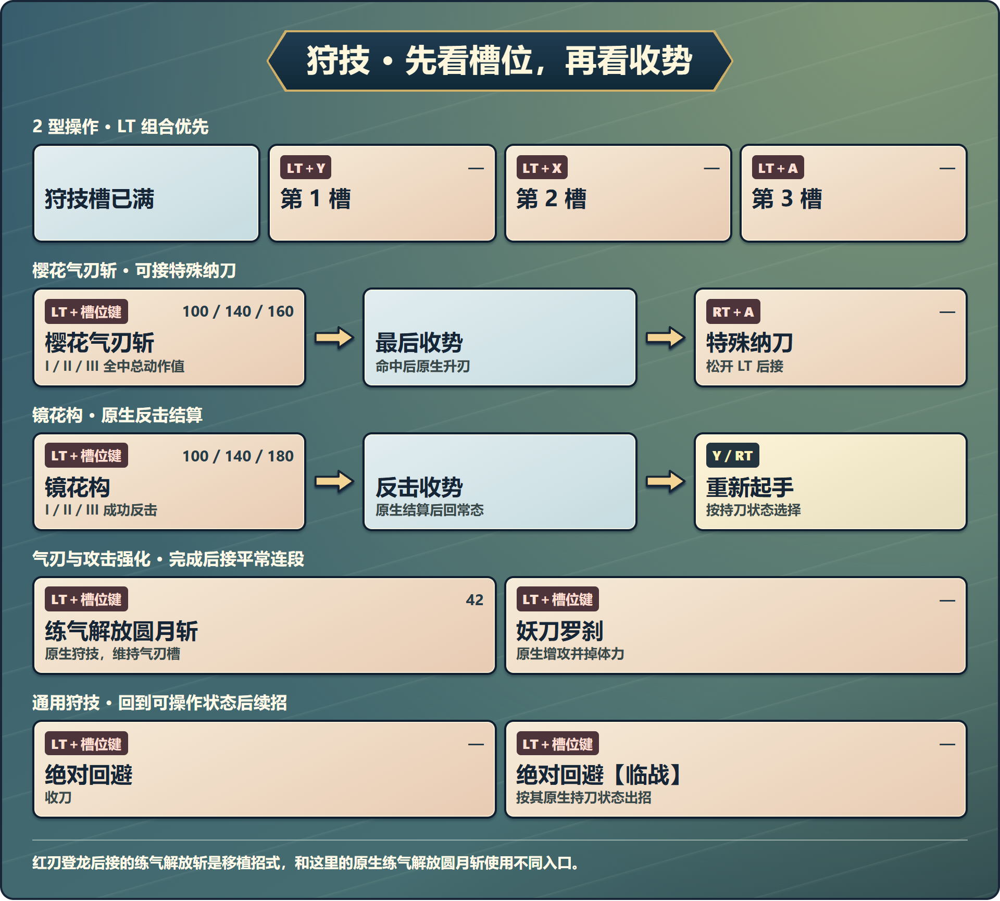

# MHGU Yuzu ZR 太刀整合版

把《世界／冰原》的见切、居合、登龙和《荒野》的赤刃、气刃蓄力、练气解放带进《怪物猎人 GU》。六种狩猎风格都能用这套太刀，勇气刚气刃、武士道无双斩等原生招式仍可使用。

**[下载 v1.2.8 整合包](https://github.com/skeyep/MHGU-Yuzu-ZR/releases/download/v1.2.8/MHGU-Yuzu-ZR-v1.2.8.zip)** · [更新记录](CHANGELOG.md) · [来源与修改说明](SOURCES.md) · [项目源码](source/BUILD.md)

适用 **Windows Yuzu 1734** 和 **MHGU 国际版 1.4.0**（`0100770008DD8000`）。包内有太刀、Forge 1.5.1、伤害跳字、快捷轮盘和可选 Xbox 按键提示。游戏、模拟器、存档和密钥由玩家自行准备。

## 安装

1. 退出游戏。下载并解压 Releases 中的 `MHGU-Yuzu-ZR-v1.2.8.zip`，双击 **Install.cmd**。
2. 如果安装器列出重复的太刀、Forge、跳字或轮盘插件，把对应旧目录移到游戏模组目录之外，再运行安装器。
3. 到 Yuzu 的游戏属性，启用 **MHGU-ZR-Integrated**。启用 **MHGU-Xbox-Prompts** 可显示 Xbox 按键。切换提示后重启游戏。
4. 在 Yuzu 控制器配置里确认 Xbox **RT 对应 ZR**，**RB 对应 R**，**LT 对应 ZL**，**LB 对应 L**。

便携版和自定义数据目录可传入 `Install.cmd -ModRoot "游戏模组数据位置" -SdmcRoot "Yuzu 的 SDMC 目录"`。检查用 `Install.cmd -Action Check`，移除用 `Install.cmd -Action Remove`。安装或移除会输出备份位置，恢复时把备份移回模组目录并还原原目录名。

## 怎么打

| Xbox 按键 | 招式 |
| --- | --- |
| RT | 气刃斩。收刀时可直接出气刃拔刀，空中调用 GU 原生跳跃气刃。 |
| RT＋A | 特殊纳刀。樱花气刃斩、气刃大回旋、武士道和勇气终结斩都可在收势时接。 |
| RT＋B | 先出一刀，再在这招的派生窗口按 RT＋B 见切。 |
| RT＋Y | 气刃突刺。开刃后命中可接登龙，红刃登龙后还能接练气解放。 |
| 特殊纳刀后 Y／重新按 RT | 小居合／大居合。大居合反击成功且刀命中才升刃，失败保留刃色。 |
| 在可派生的攻击后长按 RT | 气刃蓄力。气刃 III 后起蓄保留终结段。按住可走停，松键出刀。 |
| RB | 拔刀时收刀。继续按住并推摇杆可奔跑。 |

红刃普通 **Y** 拔刀出赤刃 I，原地短按 **RT** 可接气刃 I。红刃大回旋收势时重新按 **RT** 可接气刃旋转斩。空中是单刀还是三连斩，由 GU 原生的风格、刃色和气刃槽条件决定。

**狩技**用游戏的 **2 型操作**。LT＋Y、LT＋X、LT＋A 分别对应第 1、2、3 个狩技，优先于太刀连段。**快捷轮盘**在任务内按住 LB，用右摇杆选道具。首次安装默认放在右下，图标为 Xbox 风格。轮盘的设置在游戏菜单第 3 页。

## 连携图与动作值

卡片上方是 **Xbox 按键**，右侧数字是 **GU 1.4.0 载入整合版后的动作值**。多段攻击逐段列出。实际掉血还受刃色、斩味和肉质影响。 [文字连携和动作值说明](docs/combos.md)

### 公会

**普通斩与走位。** 拔刀站定后可以用 B 突刺垫刀，再接见切。Y＋B 可出袈裟斩，连段中配合摇杆可侧移。

**气刃和蓄力。** 短按 RT 走气刃连段，长按走蓄力。气刃 III 后起蓄会记住终结段。蓄力时可迈步、停步和转向，松开 RT 才出刀。

**见切、纳刀、居合。** 非红刃的见切先迎击并打中回斩，再按 RT 接大回旋。大居合的升刃需要迎击成功且刀命中，接气刃 III 则检查迎击成功与派生条件。

**红刃和登龙。** 红刃时 Y 走赤刃。开刃后 RT＋Y 的气刃突刺命中可腾空接登龙。红刃登龙落地后，可在派生窗口再按 RT 接练气解放斩。

### 其他五种风格

强袭、空战、武士道、勇气和炼金共用整合招式。输入窗口和原生气刃收尾随风格变化。

### 狩技

用 2 型操作时，按住 LT 后按 Y／X／A，分别释放对应狩技槽。樱花气刃斩最后收势可以按 RT＋A 接特殊纳刀。其他狩技在回到可操作状态后按原生持刀状态继续。

## 这版改了什么

- 见切、居合、登龙和见切派生回旋加入 DB 漫 RC fix1 的十段音效。登龙只在有效接触时播放首击音，回旋只在实际升刃时播放升刃反馈。
- 登龙下劈沿刀身多覆盖 32 游戏单位，横向沿用荒野移植版的宽度。
- 大居合 GP 改用随人物移动的荒野式胶囊，朝向改变时胶囊同步移动。
- Xbox 狩技提示采用浅底按键，统一三槽的图集裁切。锁定提示使用原生右摇杆下压图标。
- 修了单按 A 时旧攻击输入意外触发的情况。RT 打气刃时也不会打开联机聊天，集会所可用 View 呼出键盘。
- 空中单按 RT 会送出和手动 RT＋Y＋B 一样的原生组合。炼金空中气刃落地也接上了特殊纳刀窗口。
- 气刃大回旋命中升红时，可接此前缓冲的新 RT。红刃气刃突刺加速到 1.25 倍。
- 大居合成功反击后短时间减伤，练气解放的霸体期间有 50% 减伤。解放可命中刀身附近及角色周围，原登龙命中目标有追击保底。
- 镜花构沿用 GU 原生狩技结算。修过新动作缺事件表引起的低地址读取，以及一批音效档的 ADPCM 长度问题。

联机时建议双方安装同一版，以便各自加载相同的动作资源。

## English quick start

For **Windows Yuzu 1734** and **international MHGU 1.4.0**. Download the [v1.2.8 release ZIP](https://github.com/skeyep/MHGU-Yuzu-ZR/releases/tag/v1.2.8), close the game, extract it, and run **Install.cmd**. Enable **MHGU-ZR-Integrated** and optionally **MHGU-Xbox-Prompts** in Yuzu.

The moveset brings Foresight, Special Sheathe, Iai, Helm Breaker, Crimson Slash, Spirit Charge, and Spirit Release to all six hunting styles. **RT** (Switch ZR) handles Spirit attacks, including aerial draws. **RT+A** is Special Sheathe, **RT+B** is Foresight, and **RT+Y** is Spirit Thrust. Hold **LB** for the item wheel. Use Type 2 controls for Hunter Arts with **LT+Y**, **LT+X**, and **LT+A**.

[Credits and changes](SOURCES.md) · [Changelog](CHANGELOG.md)
