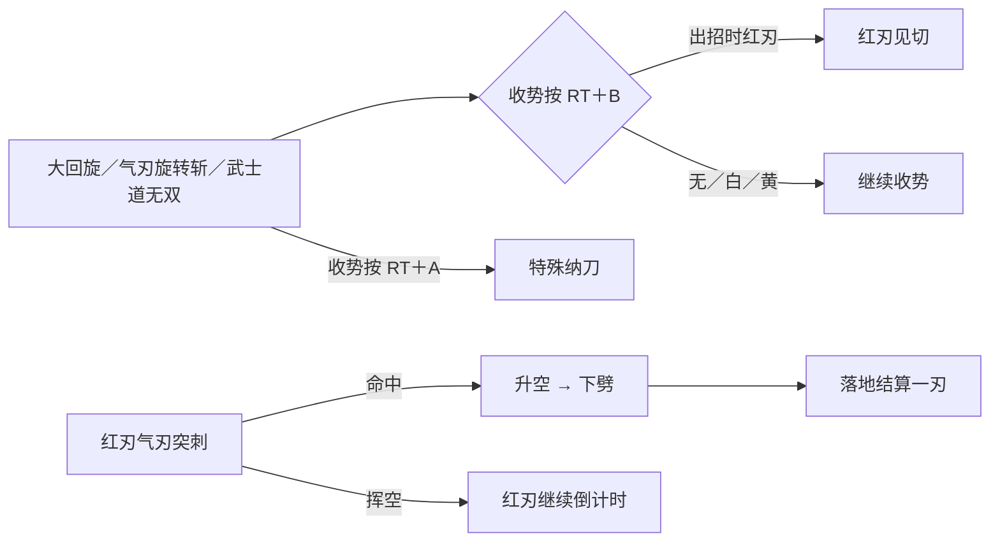

# GU 太刀连携与动作值

本页使用 Xbox 按键。**RT／RB／LT／LB** 对应 **ZR／R／ZL／L**，**Y／B／A／X** 对应 **X／A／B／Y**。方向为左摇杆输入。箭头表示在前一招的派生窗口内输入。

## 公会

| 路线 | 输入、条件和动作值 |
| --- | --- |
| 普通斩 | Y 踏步斩 **26** → Y 纵斩 **26** → B 突刺 **14** → Y 上挑 **18**。拔刀待机也可用 B 突刺垫刀。 |
| 后撤和侧移 | Y＋B 后撤袈裟斩 **24**。连段中加左或右方向可出侧移袈裟斩 **24**。公会三种袈裟收势时按 RT 可接原生气刃踏步斩 **30**，摇杆回中或保持方向均可。再按 RT 可接气刃 III。 |
| 气刃 | 依次短按 RT 出气刃 I **31**（不足 15 气刃时弱斩 **14**）、II **30**、III **14＋19＋34**、大回旋。I 后按 Y 可插突刺 **14**，II 后按 Y 可插上挑 **18**。II、III、普通回旋的槽量门槛分别为 **15、20、25**，红刃适用免耗。 |
| 大回旋 | 整合版普通大回旋 **38**，红刃及原生大回旋 **42**。命中可升刃。红刃回旋收势时单按 RT 接气刃旋转斩 **60**，RT＋A 接特殊纳刀。先按 RT 再立即补 A 也可输入组合。 |
| 方向气刃 | 收刀时直接推方向＋RT，拔刀时在允许窗口输入。收刀气刃槽不足时用弱气刃 I 的动作值。移动气刃 I 前／左／右 **24**，后撤 **20＋12**。移动气刃 II **12＋28**，继续 RT 回到气刃 III。 |
| 蓄力 | 兼容的普通攻击或气刃派生窗口内长按 RT。蓄力填充原生气刃槽，按住可走停，松开出招。气刃 I 后短蓄可接气刃 II，带方向可出移动 II。气刃 II 后短蓄松手出蓄力气刃 III。任意阶段满蓄都可出大回旋，气刃 III 后进入蓄力时直接满蓄。 |
| 非红刃见切 | 先垫一刀，再按 RT＋B。回斩 **12**。起手前气刃槽≥10 可触发迎击。迎击和回斩命中都成立时，再按 RT 接大回旋。 |
| 红刃见切 | 垫刀后 RT＋B，双段 **22＋13**。在红见切自己的窗口按 RT 接大回旋 **42**，再按 RT 接旋转斩 **60**。 |
| 小居合 | RT＋A 特殊纳刀，架势就绪后按 Y。小居合 **18＋13**。命中后自动回气。短按 RT 可接气刃 II，RT＋A 可再次特殊纳刀。 |
| 大居合 | RT＋A 后重新按 RT，刀击按无刃／白／黄／红为 **17／19／31／39**。迎击且刀命中时，追加 **55／55／72／86**，同时升一层刃或在红刃恢复时间。失败保留刃色。以下派生表单独列出 GP 成功、失败和持键的区别。 |
| 赤刃 | 红刃 Y 拔刀或在允许的攻击间按 Y。大回旋将刀收回后也可按 Y 拔刀。赤刃 I 站定 **33＋16**、移动 **11＋22**、后撤 **30**，II **11＋22**，III **30＋18＋55**。III 后可回赤刃 I。原地赤刃 I 和原地气刃 I 可用 Y／短 RT 交替。 |
| 登龙 | 收刀或拔刀时 RT＋Y 气刃突刺 **26**。开刃且突刺命中后腾空，左摇杆可微调位置，重新按 RT 或等待自动下劈。白／黄／红刃分别为 **10×7／15×7／25×7**。 |
| 练气解放斩 | 红刃起手的登龙落地后按 RT。 |
| 登龙落地 | RT＋A 接特殊纳刀。红刃登龙在专用窗口接 RT 可出练气解放斩。动作值为 **5×3＋(9＋14＋20＋32)×3**，全中合计 **240**。 |

蓄力气刃 III 的三段动作值为 **20＋18＋26**。派生成气刃 II 或大回旋时，结算对应动作的数值。

大居合 GP 的有效时间为 0.30 秒。胶囊随角色移动，中心向当前面向前移 50 GU 单位，两个端点相对脚底高 75 和 45，半径 150。侧面攻击只要碰到胶囊也能触发。

## 登龙与终结斩连携

红刃气刃突刺命中 → 起跳 → 空中 → 下劈 → 落地结算一刃。挥空继续倒计时；空中保护保留命中时剩余时间。提前退出时按已进入的阶段结算。

| 前一招 | RT＋B 红刃见切（可输入／可出招） | RT＋A 特殊纳刀（无、白、黄、红） |
| --- | --- | --- |
| 原生大回旋 | F58／F62 | F50 |
| 红见切派生大回旋 | F46／F50 | F50 |
| 满蓄大回旋 | F51／F55 | F55 |
| 气刃旋转斩 | F39／F69 | F69 |
| 武士道气刃无双斩 | F106／F110 | F110 |

以上五条在实际出招帧检查刃色。黄刃预输入后升红可接红见切；红刃预输入后掉黄则结束这次输入。武士道一文字仍使用原来的见切窗口。

## 见切的输入时机

普通刀和赤刃可挥空垫刀。连携窗内按 RT＋B，先按任一键再补另一键时，两键要有短暂重叠。见切后再用见切，需要先出另一刀。回到自由移动、被打断或切换动作后，上一刀的输入失效。

| 上一刀 | 接见切的窗口（动作帧） |
| --- | --- |
| 红见切后派生的大回旋 | F46 起可输入，F50 起出刀。满蓄大回旋为 F51／F55。 |
| 武士道持刀一文字、气刃无双斩 | 一文字 F86／F90，无双 F106／F110。单按 RT 仍走原生派生。 |
| 气刃蓄力起手 | 相对起手 F16 可输入，F20 起出刀，F50 关闭。不同蓄力段按自己的起始姿势计算。 |
| 登龙落地、练气解放斩 | 落地 F60／F80。解放斩末段 F126／F130，到 F140 收刀关闭。 |
| 樱花、练气解放圆月斩、镜花构 | 只收后摇中新按的组合键。樱花最后收势动画 F1、圆月独立收势动画 F113、镜花成功反击动画 F102 起生效。镜花架势不接受。 |

## 大小居合的派生

GP 指大居合挥刀时的迎击判定。下表中的 F 是招式动画内的帧。实战可以按挥刀和收势判断时机，命中停顿会改变体感节奏。

| 当前招式与条件 | 输入 | 派生 |
| --- | --- | --- |
| 大居合 GP 成功 | 松开后重新短按 RT | F70 起接受新的短按。此前点按不会留到收势后出招。推摇杆也走气刃 III 路线。标准气刃 III 需要 20 点气刃，红刃免耗。升刃还需要刀命中。 |
| 大居合 GP 成功 | 继续按住 RT，或重新长按 RT | F70 起，持键约 0.60 秒进入 III 段蓄力。短蓄松开出三段蓄力斩，满蓄松开出大回旋。 |
| 大居合 GP 成功 | RT＋A | F50 起可预输入，F70 起接特殊纳刀。 |
| 大居合 GP 成功，武士道 | 单按 Y | F24 起接受新的 Y 按下。首次有效输入后等 5 个动作帧，最早 F37 进入原生拖刀；重复按 Y 不重置计时。拖刀减速时自动出一文字斩 **25**。拖刀中松开再按 Y 可按原生窗口提前出刀。气刃足够时接 RT 气刃无双斩 **30＋80**，收势按 RT＋A 特殊纳刀。 |
| 大居合 GP 成功，公会／强袭／空战／炼金，已是红刃或这刀刚升红 | Y，或方向＋Y | F50 起可预输入，F70 起接原地或方向赤刃 I。 |
| 大居合 GP 成功或失败 | RT＋Y | 可缓冲气刃突刺，F70 起进入演出的起步段。已有刃色且突刺命中后才进入登龙。 |
| 大居合 GP 失败 | 继续按住 RT 约 0.60 秒，或松开后重新按住约 0.25 秒 | F37 起可进 II 段蓄力。短蓄时回中松开接气刃 II，勇气蓝刃接刚气刃 II。推杆松开可出移动气刃 II，非红刃需至少 15 点气刃。蓄力起手保持 RT 并补按 A，可接特殊纳刀。 |
| 大居合 GP 失败 | 短按 RT 或直接 RT＋A | 这两个直接派生要求 GP 成功。失败后的连续出招用上面的蓄力或气刃突刺分支。 |
| 小居合 | 短 RT／长 RT／RT＋A | 短按续气刃 II。长按进入蓄力。RT＋A 从 F24 起可预输入，F42 起接特殊纳刀，架势就绪后可再按 Y 小居合。 |
| 小居合，勇气风格 | X | F24 起可预输入，F42 起接勇气原生纳刀。按住 X 可维持架势。 |
| 小居合 | RT＋Y／RT＋B | 收势可接气刃突刺／见切。见切仍按当前气刃状态判定。 |
| 小居合 | Y／B／Y＋B／A | 红刃 Y 可接赤刃 I。非红刃的 Y、B 可回普通攻击，Y＋B 可接袈裟，A 可在回避窗口翻滚。 |

## 拖刀、移动气刃与一文字斩

如果你说的「拖刀斩」是**推摇杆＋RT 出的移动气刃**，大居合后要多走一段。GP 成功后长按 RT → 短蓄松开出三段蓄力斩 → 收势时新按方向＋RT 接大回旋。GP 失败后进 II 段蓄力，短蓄时推杆并松开 RT，可出移动气刃 II。大回旋和移动气刃 II 仍需满足各自的气刃槽门槛。气刃蓄力时的持刀走步和 RT＋Y 气刃突刺的拖刀起步，用上表对应的输入。

| 起手或上一招 | 输入时机 | 后续 |
| --- | --- | --- |
| 拔刀待机或部分普通斩 | 待机推方向＋RT，或从普通斩 F24 起在收势按方向＋RT | 移动气刃 I，非红刃需要至少 10 点气刃。方向取按 RT 的时刻。 |
| 气刃 I | 在下一段窗口新按方向＋RT，再松开 | 气刃够时进移动气刃 II。摇杆回中短按则走原地 II。 |
| 移动气刃 I | 挥刀后新按 RT | 继续推杆进入移动气刃 II，回中进入气刃 II。勇气蓝刃回中进刚气刃 II。长按则可进入蓄力。 |
| 移动气刃 II | 挥刀后新按 RT | 接气刃 III。勇气蓝刃回到刚气刃链，后续仍可走勇气终结斩。 |
| 移动气刃 I／II | 收势按 RT＋A、RT＋B 或 RT＋Y | 分别接特殊纳刀、见切、气刃突刺。也可按 A 回避，按 Y 接普通起手或红刃赤刃 I，按 B 接突刺。 |
| 移动气刃 I／II → 武士道一文字 | 先按 A，成功触发精准回避后按 Y | 一文字斩 **25**，再按 RT 可接气刃无双斩。普通翻滚后的 Y 走原生普通攻击。 |
| 移动气刃 I／II → 勇气一文字 | 收势后长按 X，进勇气原生纳刀持续，再按 Y | 勇气一文字斩。蓝刃下，移动气刃收势时直接按 Y 回普通斩，按 RT 续刚气刃。 |

移动气刃挥完直接按 Y 走普通斩或赤刃。移动气刃 I 的短 RT 续斩窗口随方向从 F48、F53 或 F78 开始，移动 II 从 F60、F68 或 F75 开始。可在临近收势时预输入，气刃足够时接续。

## 五种风格差异

| 风格 | 和公会不同的原生段及接回点 |
| --- | --- |
| 强袭 | Y＋B 原生后撤袈裟斩 **24**，保留四段地面气刃和三狩技槽。袈裟直接转气刃踏步斩的原生捷径是公会路线。 |
| 空战 | A 踩踏跳跃或从高低差起跳，空中 RT 调用原生跳跃气刃。白刃及以上且气刃槽满足原生条件时可走三连斩，按当前阶段落地续气刃和大回旋。地面移植招式在对应派生窗口起手。 |
| 武士道 | A 精准回避进入拖刀后按 Y，或大居合 GP 成功后按 Y 进入拖刀并等到收尾（可再按 Y 提前出刀） → 一文字斩 **25** → 气刃足够时 RT 气刃无双斩 **30＋80** → 收势 RT＋A 特殊纳刀。无双命中可升刃。原生地面气刃连段做到 III，见切回旋走整合版派生。 |
| 勇气 | X 持续原生纳刀，Y 一文字斩、Y＋B 袈裟或 RT 气刃踏步。纳刀派生收势可接见切或特殊纳刀。蓝刃 RT 走带 GP 的刚气刃 I **28／51**，续 II **30**、终结 **35＋60**。终结可配合摇杆移动，收势可 RT＋A。蓝刃登龙按红刃档结算。 |
| 炼金 | B 可出左移动斩 **24**，普通 Y 连段可接突刺。气刃 II、III、大回旋命中加快炼金槽积攒。空中气刃临落地可缓冲 RT＋A，在落地收势接特殊纳刀。 |

### 勇气槽与反击

勇气槽上限为 1,000 点。见切、小居合或大居合成功迎击并命中时，入蓝前基础增加 90 点，入蓝后基础回复 18 点。GU 会按太刀状态和技能倍率结算并取整，蓝中一次反击可能只回 3 点。其他原本升刃的奖励也计入勇气槽。蓝刃登龙在升空时消耗 55 点，出下劈时再耗 45 点，完整一套消耗 100 点（满槽的 10%）。起跳前被打断不扣槽，起跳后至下劈前被打断只扣 55 点。气刃无双斩发动终结段时消耗 100 点。勇气蓝刃的登龙使用红刃伤害档。普通 Y 始终走原生斩击，见切使用普通见切动作。

被泥或雪裹住时，当前太刀招式会中止。按原版方式挣脱或使用消散剂，解除后可以重新出刀。泡沫滑倒、裹泥和裹雪时，RT 不会打开快捷聊天。

## 狩技

用 **2 型操作**。LT＋Y／LT＋X／LT＋A 对应第 1／2／3 槽。槽位已安装并可释放时才会出招。组合键中的面键松开后，可作为后续太刀输入再次按下。

| 狩技 | 动作值和接回点 |
| --- | --- |
| 樱花气刃斩 | I／II／III 全中 **100／140／160**。命中后按 GU 原生规则升刃。最后一段收势松开 LT，再按 RT＋A 可接特殊纳刀。 |
| 镜花构 | I／II／III 成功反击 **100／140／180**。沿用 GU 原生狩技槽和刃色结算。反击后摇重新按 RT＋B 可接见切。 |
| 练气解放圆月斩 | 起手斩 **42**，原生狩技效果维持气刃槽，收势后可回常用连段。红刃登龙后按 RT 出的练气解放斩属于移植招式。 |
| 妖刀罗刹 | 强化攻击并消耗体力。起手完成后可继续常用连段。 |
| 绝对回避／绝对回避【临战】 | 通用狩技。绝对回避会收刀，恢复操作后可用 Y 或 RT 拔刀。临战按结束时的持刀状态续招。 |

动作值来自整合版太刀攻击表和动作派发。原生分支可对照 [Capcom《MHXX》Switch 版太刀手册](https://game.capcom.com/manual/MHXXS/page/11/2) 与 [整合源码](../source/BUILD.md)。

### 1.2.24 → 1.2.25 逐帧对照

| 收势 | 1.2.24 可接见切的刃色 | 1.2.25 可接见切的刃色 |
| --- | --- | --- |
| 原生大回旋、红见切派生大回旋 | 红 | 红 |
| 满蓄大回旋、武士道无双 | 无、白、黄、红 | 红 |
| 气刃旋转斩 | 红，收势前掉色也可接普通见切 | 红 |
 
五条路线 × 四档刃色 × 两个组合键共 40 项。可接普通见切的非红组合由 9 项降到 0 项，红见切保留 5 项，特殊纳刀保留 20 项。旋转斩的非红用例模拟动作已起手后掉色。

